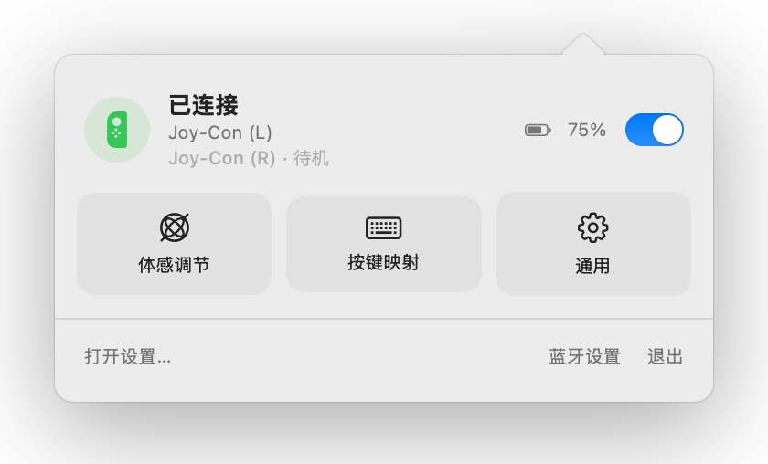
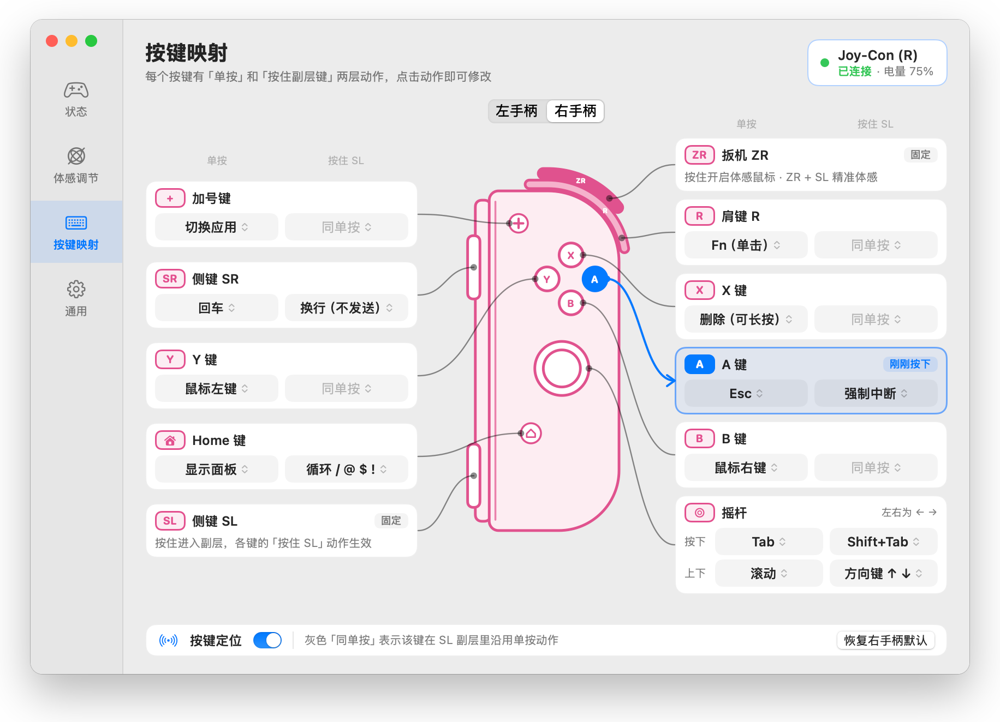
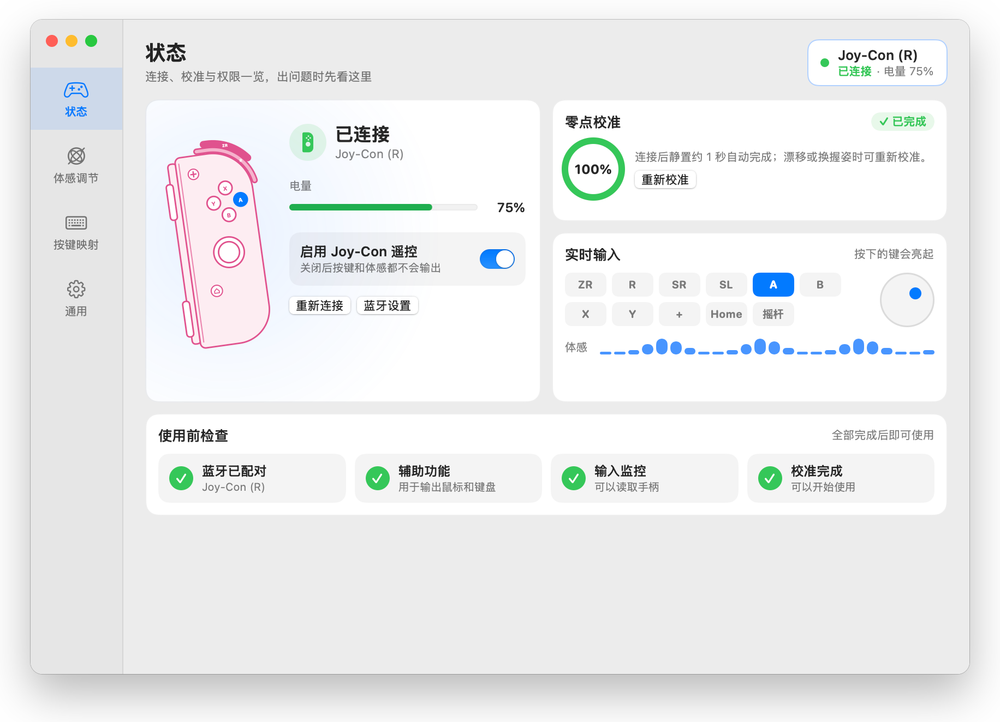
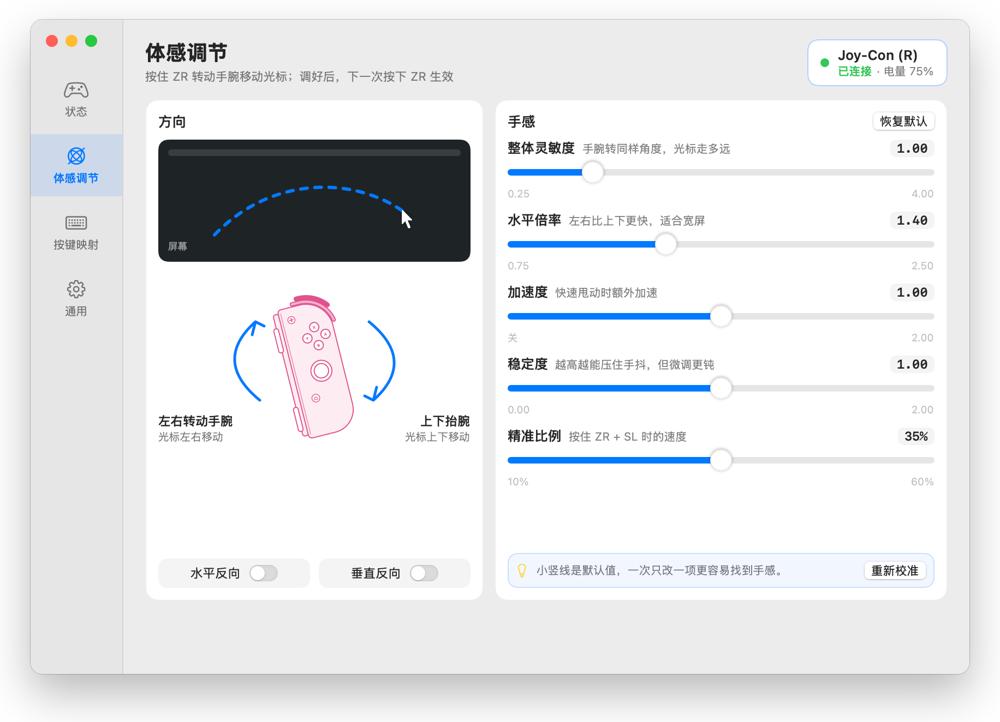
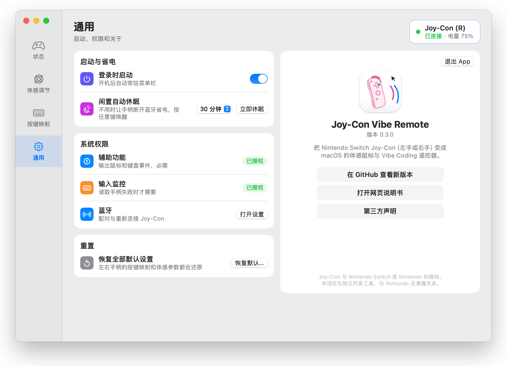
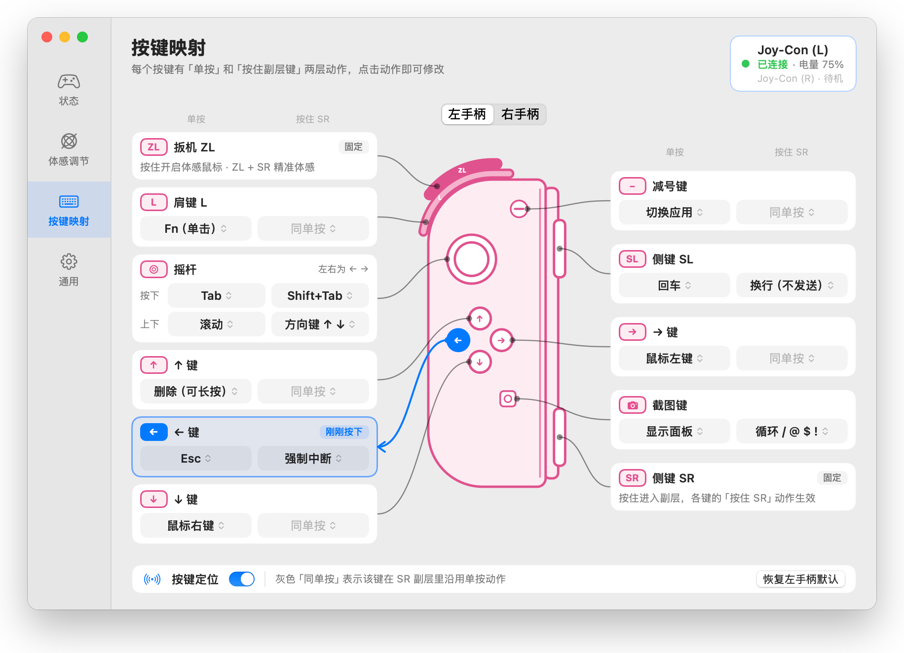

# Joy-Con Vibe Remote

English | [简体中文](README.zh-CN.md)

> Turn a Nintendo Switch Joy-Con into a motion mouse and Vibe Coding remote for macOS.

Joy-Con Vibe Remote is a lightweight macOS menu bar app. It reads the Joy-Con's
gyroscope and accelerometer so you can move the cursor with your wrist, and maps
the physical buttons to mouse clicks, keystrokes and common Agent actions.

It is made for driving Codex, Claude Code and everyday macOS apps from the couch
or a podium, when your screen is on a TV or projector and the keyboard is out of
reach.

> [!IMPORTANT]
> The Joy-Con has no microphone. The R button can trigger macOS Dictation, but
> voice input needs the Mac's built-in microphone or a wired or wireless one.

> [!NOTE]
> The app's interface is in Simplified Chinese. The screenshots below show it
> as it appears, and this README gives the English meaning of each label you
> need, with the original in brackets, for example General (通用).

## Download

No Xcode or compiling required:

1. Open the [Releases page](https://github.com/hunduncn/joycon-vibe-remote/releases/latest) and download the latest
   `Joy-Con-Vibe-Remote-x.y.z.dmg`;
2. Open the DMG and drag `Joy-Con Vibe Remote` into Applications;
3. Launch the app from Applications.

> [!NOTE]
> The DMG supports **Apple silicon (M-series) Macs** only and requires macOS 14 or later.

### If macOS blocks the first launch

The app is not notarized by Apple, so the first launch shows a warning that the
developer cannot be verified. This is normal for unnotarized apps. Allow it once
and it will not ask again:

1. Double-click the app and click Done in the warning;
2. Open System Settings → Privacy & Security, scroll down to Joy-Con Vibe Remote and click Open Anyway;
3. Click Open in the confirmation dialog and enter your password.

If you are comfortable with Terminal, you can instead remove the download
quarantine flag after copying the app to Applications:

```bash
xattr -dr com.apple.quarantine "/Applications/Joy-Con Vibe Remote.app"
```

For pairing, permissions and calibration after launch, see [Getting started](#getting-started).

## Web manual

[Open the web manual](https://hunduncn.github.io/joycon-vibe-remote/manual/) (Chinese) · [View its source](docs/manual/index.html)

The manual covers:

- Bluetooth pairing, permissions and stillness calibration;
- The normal layer, the SL Agent layer and the ZR motion layer;
- A Vibe Coding workflow;
- Settings and troubleshooting;
- Responsive layouts for phone and desktop, plus print/PDF styles.

After cloning the repository, open `docs/manual/index.html` in a browser to read it offline.

## Default button guide


The same mapping is listed in English under [Default button mapping](#default-button-mapping).

## Features

- **Motion mouse:** hold ZR to move the cursor and release to stop at once.
  Each press re-anchors the direction to how you are holding the controller.
- **Precision mode:** hold ZR + SL to aim at small buttons and text carets with lower sensitivity.
- **System dictation:** R sends a single Fn press, which works with macOS's "press Fn to start dictation".
- **Mouse and keyboard:** left click, right click, Return, Delete, Esc, Tab, arrow keys and app switching.
- **Agent layer:** hold SL to insert a newline without sending, force-interrupt, move focus backwards,
  and use the stick as real up/down arrow keys.
- **Command symbols:** hold SL and tap Home repeatedly to type `/`, `@`, `$` and `!` in turn.
- **Idle sleep:** after the controller sits idle for a while (30 minutes by default) it drops its
  Bluetooth link to save battery. Press any button to wake it; it reconnects without recalibrating.
- **Left-handed use:** the left Joy-Con works just like the right one, with each button in the mirrored
  position, for left-handed people or anyone who prefers their left hand. With both connected, whichever
  you press a button on takes over, and each keeps its own button mapping. See [Left Joy-Con](#left-joy-con).
- **Settings window:** click Open Settings… (打开设置…) in the menu bar panel. Four pages, Status (状态),
  Motion (体感调节), Button Mapping (按键映射) and General (通用), show the connection and calibration,
  tune the feel, and set each button's "press" and "hold SL" actions on a drawing of the controller.
  Pressing a button on the Joy-Con highlights its setting.

## Screenshots

### Menu bar panel

Click the menu bar icon to see the connection and battery, toggle the remote, and jump to any settings page.

<picture>
  
</picture>

### Button Mapping

Set each button's "press" and "hold layer key" actions on a drawing of the controller. The Left controller | Right controller
(左手柄 | 右手柄) switch at the top picks which one you are editing, starting with the one in use. Pressing a button on
the Joy-Con highlights its card and leader line.

<picture>
  
</picture>

### Status

Connection, battery, zero-point calibration, live input, and a pre-flight checklist with a button for each missing permission.

<picture>
  
</picture>

### Motion

A diagram explains how wrist movements map to the cursor. Every slider has a description, and a tick marks its default value.

<picture>
  
</picture>

### General

Launch at login, idle sleep, permission status, reset to defaults, and version information.

<picture>
  
</picture>

## Default button mapping

| Joy-Con input | Normal layer | While holding SL |
| --- | --- | --- |
| R | Single Fn press (system dictation) | Same as normal |
| SR | Return / Enter | Shift + Enter (newline without sending) |
| A | Esc | Control + C (force interrupt) |
| B | Right click | Same as normal |
| X | Delete; hold to repeat | Same as normal |
| Y | Left click; hold to drag | Same as normal |
| + | Command + Tab (switch apps) | Same as normal |
| Home | Open the status panel | Tap repeatedly to cycle `/ → @ → $ → !` |
| Stick press | Tab | Shift + Tab |
| Stick up/down | Scroll | Up / down arrow keys |
| Stick left/right | Left / right arrow keys | Left / right arrow keys |
| ZR | Hold for motion mouse | ZR + SL for precision mode |

The ZR + SL precision combo takes priority over the SL Agent layer, so it never triggers layer actions by accident.

## Left Joy-Con

The left Joy-Con's buttons map to the right controller's buttons in the mirrored position and do the same
things. Held upright in the left hand, **SR** at the bottom of the rail is the layer key, so "while holding SR"
below is the same layer as "while holding SL" on the right controller. Motion direction is converted
automatically; you do not need the invert switches.

| Left Joy-Con | Right equivalent | Normal layer | While holding SR |
| --- | --- | --- | --- |
| ZL | ZR | Hold for motion mouse | ZL + SR for precision mode |
| L | R | Single Fn press (system dictation) | Same as normal |
| SL | SR | Return / Enter | Shift + Enter (newline without sending) |
| ← | A | Esc | Control + C (force interrupt) |
| ↓ | B | Right click | Same as normal |
| ↑ | X | Delete; hold to repeat | Same as normal |
| → | Y | Left click; hold to drag | Same as normal |
| − | + | Command + Tab (switch apps) | Same as normal |
| Capture | Home | Open the status panel | Tap repeatedly to cycle `/ → @ → $ → !` |
| Stick press / up-down / left-right | Same as right | Same as right | Same as right |

Each controller keeps its own button mapping; switch between them at the top of the Button Mapping page.

<picture>
  
</picture>

**With both connected:** whichever you press a button on takes over. Pick up the other one and press any
button to switch (that press only switches; it acts if you keep holding it); the idle one is shown as standby (待机). Bumping a stick or moving a controller never
switches, and neither does pressing the other controller while you hold the trigger or any other button.
The standby controller only reports button presses, so two connected controllers do not make motion
stutter. If the controller in use disconnects or goes to sleep, the other one takes over. Sleep now (立即休眠) puts
every connected controller to sleep.

## Requirements

- macOS 14 or later. The downloadable DMG supports Apple silicon only; on Intel Macs, build from source;
- An original Nintendo Switch Joy-Con (R) or Joy-Con (L), or both;
- A Bluetooth connection;
- The Accessibility permission, plus Input Monitoring if macOS blocks HID input;
- A microphone if you want voice input.

## Getting started

1. Pair `Joy-Con (R)` or `Joy-Con (L)` in macOS System Settings → Bluetooth;
2. Grant the app the Accessibility permission when prompted;
3. Once connected, leave the Joy-Con still for about a second while it calibrates its zero point;
4. Hold ZR (ZL on the left controller) and gently turn your wrist to move the cursor.

If nothing happens after granting permissions, click Reconnect (重新连接) in the error message, or turn the
remote toggle in the panel's top-right corner off and on again. Opening the panel also retries any device
that failed to open earlier. If macOS says the app must quit and reopen, quit it and launch it again from
where it is installed.

Launch at login (登录时启动) is on the General (通用) page of the settings window. If it is waiting for system
approval, the page says so; turning it off withdraws the pending registration.

The same page sets idle sleep, Idle auto-sleep (闲置自动休眠): Off / 10 minutes / 30 minutes / 1 hour.
There is also a Sleep now (立即休眠) button. While the controller sleeps, the menu bar icon turns into a
moon; press any button on the Joy-Con to wake it.

## Build from source

Most people should just [download the DMG](#download); this section is for developers.

Building from source needs **the full Xcode 16 or later (with Swift 6+ and the macOS SDK)**.
Install an Xcode version compatible with your macOS, then open it once to finish installing components
and accept the license. The Command Line Tools from `xcode-select --install` are not enough: some SwiftUI
SDKs need compiler plugins that only ship with the full Xcode. Check the current tools with:

```bash
xcode-select -p
xcrun swift --version
```

The scripts prefer the currently selected full Xcode. If only the Command Line Tools are selected, they
look for an installed Xcode through Spotlight. You can also point `DEVELOPER_DIR` at another Xcode,
for example `DEVELOPER_DIR="/Applications/Xcode-beta.app/Contents/Developer" ./scripts/build-app.sh`.
Update your developer tools if the Swift version is too old, and set the path by hand if Spotlight
cannot find Xcode.

```bash
git clone https://github.com/hunduncn/joycon-vibe-remote.git
cd joycon-vibe-remote
./scripts/build-app.sh --install
open "/Applications/Joy-Con Vibe Remote.app"
```

The build script produces and installs:

```text
/Applications/Joy-Con Vibe Remote.app
```

If your account cannot write to `/Applications`, install into your home folder instead, without `sudo`:

```bash
./scripts/build-app.sh --install --install-dir "$HOME/Applications"
open "$HOME/Applications/Joy-Con Vibe Remote.app"
```

When upgrading, the script first copies and checks the new build, then quits the old app in the install
folder and replaces it. It stops if the old app fails to quit, and restores the old version if the
replacement fails. After a successful upgrade, the old version is kept in a hidden
`.joycon-vibe-remote-install.*` folder in the install location, and Terminal prints its path. Delete
it yourself once the new version works. The third-party notices are also bundled in the app at
`Contents/Resources/THIRD_PARTY_NOTICES.md`.

To package the DMG for a release:

```bash
./scripts/make-dmg.sh
```

The output is `.build/dmg/Joy-Con-Vibe-Remote-<version>.dmg`, with the version taken from `Resources/Info.plist`.
The script installs dmgbuild into the project-local `.build/dmg-tools` to lay out the installer window, and
sets the background image through Finder. A Finder window briefly appears while it packages, and the first
run may ask you to allow Terminal to control Finder.

## macOS Dictation setup

The R button only sends a single Fn press to macOS; it does not record audio itself. To use it as a voice key, go to:

```text
System Settings → Keyboard → Dictation → Shortcut
```

and set dictation to start or stop with a single press of Fn. Shortcuts vary between macOS setups,
so follow what your Mac shows.

## Motion tips

- Treat ZR as the mouse's clutch: hold it to move, release it once you reach the target;
- Keep your wrist steady at the moment you press ZR, and avoid flicking;
- After changing your grip, release and press ZR again to re-anchor the direction;
- Raise Stability (稳定度) if the cursor jitters, and adjust Horizontal multiplier (水平倍率) if sideways movement feels slow;
- Change one setting at a time; it is easier to find a feel that suits you.

## Project structure

```text
Sources/JoyConVibeCore/       HID data, button mapping and motion algorithms
Sources/JoyConVibeRemote/     macOS menu bar app and system event output
Tests/                        Parsing, mapping, motion and UI regression tests
docs/manual/                  Responsive web manual
docs/assets/                  Hand-drawn button guide and other doc assets
scripts/build-app.sh          Release build and install script
scripts/make-dmg.sh           DMG packaging script
```

## Development and testing

```bash
DEVELOPER_DIR="/Applications/Xcode.app/Contents/Developer" xcrun swift test
python3 scripts/test-install.py
```

You can also open `Package.swift` directly in Xcode. HID parsing, motion algorithms and button mapping
are separate from the AppKit/SwiftUI interface, and the automated tests never send real system input events.

## Third-party notices

Sources of third-party code and algorithms are listed in [THIRD_PARTY_NOTICES.md](THIRD_PARTY_NOTICES.md).

Joy-Con and Nintendo Switch are trademarks of Nintendo. This project is an independent developer tool
and is not affiliated with or endorsed by Nintendo, OpenAI or Anthropic.
